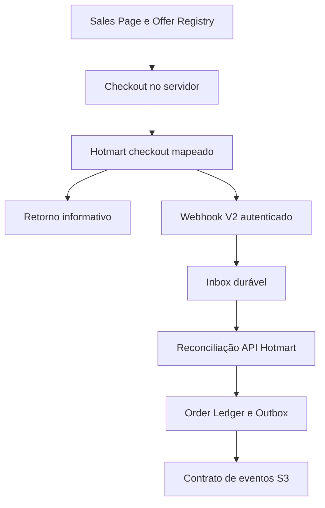

# S2 — auditoria Hotmart e design Commerce / Checkout

Data: 2026-10-14. Estado: **DESIGN PROPOSTO / AUDITORIA DA CONTA PENDENTE**.
Issue #26. Não declara S2 implementado, checkout validado ou SALES READY.

## Baseline e fronteira de trabalho

- S1 homologado: `7d72b7ce2e22f5712f74ef9b6302b6c7d22f3ed2`, PR #29 DRAFT.
- Branch S2 existente, confirmada por fetch: `feat/sales-s2-commerce-checkout`, criada nesse SHA.
- PR S2 empilhado com base `feat/sales-s1-collection-landing`; não depende de merge em main.
- S1, Reader, Library, Journey e masters permanecem intactos. Nenhum grant em S2.
- `gate.salesReady=false`, `purchaseEnabled=false`. Só este documento é adicionado nesta etapa.
- Main dispara deploys existentes: aprovação de design/CI/smoke não autoriza merge ou publicação.

## 1. Auditoria observada e limites

Acessado `https://app.hotmart.com/`: redireciona para login Hotmart. Não havia sessão
utilizável; a solicitação segura de autenticação terminou sem conclusão. Não foram
inspecionados produtos, ofertas, tokens ou configurações privadas. Nenhuma alteração
foi feita na Hotmart. Não há conector Hotmart disponível nesta sessão.

No repositório, o Offer Registry contém os seis preços PDG aprovados, mas nenhum
mapping Hotmart. A API Fastify regista apenas health/waitlist; não contém checkout,
webhook, Order ou processador de pagamentos. Env schema não declara Hotmart.
Drizzle/Postgres já existem; o arranque aplica migrations automaticamente e continua
após falha de migration. Commerce terá de falhar fechado se o seu schema não estiver
pronto, sem regredir health/waitlist. Nenhuma base de dados foi consultada nesta auditoria.

### Inventário Wave 1

| offerId interno | Oferta | BRL aprovado | product ID / ucode Hotmart | offer code / link direto | Conclusão |
| --- | --- | ---: | --- | --- | --- |
| p01 | 7 Dias Para Me Escolher | 11,90 | Não verificado | Não verificado | Auditar conta |
| p02 | Eu Sou Bela — Do Meu Jeito | 19,90 | Não verificado | Não verificado | Auditar conta |
| p03 | 21 Dias — Meu Melhor Reflexo | 29,90 | Não verificado | Não verificado | Auditar conta |
| p04 | Recomeçar Depois dos 40 | 24,90 | Não verificado | Não verificado | Auditar conta |
| p05 | Diário de Amor-Próprio | 29,90 | Não verificado | Não verificado | Auditar conta |
| colecao | Coleção P01–P05 | 79,90 | Não verificado | Não verificado | Auditar conta |

**Não verificado não significa ausente.** Ainda não é possível listar quais ofertas
precisam de criação. Não criar duplicados até completar o inventário. Nenhum ID/link
de exemplo da documentação é um ID/link do EspelhoMeu. Jornada, Membership e bundles
candidatos ficam fora do checkout Wave 1, independentemente de terem preço no registry.

### Dados que fecham a auditoria da conta

Inspeção read-only pelo PDG/operador ou export sanitizado, sem secrets nem compradores:

1. Conta produtora correta e escopo; produtos por nome, ID numérico, ucode, tipo e estado.
2. Para cada produto: offer code, link direto copiado da plataforma, valor/moeda,
   pagamento único, condições, conversão de moeda, recuperação, cupons e order bumps.
3. Confirmar se Coleção é produto comercial próprio e se entrega P01–P05 sem cobranças adicionais.
4. Webhook existente: versão, produtos/eventos selecionados, URL, estado e histórico de teste
   sanitizado. Não copiar Hottok para documento/chat/repositório.
5. Configuração real das páginas de obrigado aprovada e pendente; comportamento de cancelamento.
6. Existência de credencial API com acesso aos produtos/ofertas/vendas necessários e ambiente;
   apenas confirmar existência/escopo, sem revelar valores.
7. Entrega Hotmart atual: PDF/Club/externa, mensagens de acesso e suporte. Resolver qualquer promessa
   de entrega imediata antes de cobrar, pois o acesso AMF exige S3.

Resultado esperado: matriz comprovada `project + provider account + product + offer → offerId`,
com link original, evidência, data e revisão. Só depois decidir criar/corrigir cada oferta.

## 2. Contratos do provider verificados em documentação oficial

- Compra externa pode redirecionar para a página de pagamento Hotmart; escolher redirect
  direto para Wave 1, sem SDK embedded/overlay ou formulário de CPF no EspelhoMeu.
- API de ofertas: `GET /products/api/v1/products/:ucode/offers`, com Bearer token;
  expõe `code`, `price`, `payment_mode` e `direct_offer_link_for_creator` [H1].
  O link retornado/copido é autoridade de destino; nunca construir a partir do nome do produto.
- API usa OAuth 2.0 client credentials; Hottok de webhook e credenciais OAuth são
  mecanismos separados [H2]. Redirect estático não precisa de OAuth no browser.
- Webhook V2 usa `X-HOTMART-HOTTOK`; identificador do evento e transação têm papéis
  distintos [H3]. Tratar Hottok como segredo partilhado da conta, não como assinatura
  HMAC do corpo, autorização de utilizador ou credencial de checkout.
- Há páginas de obrigado externas distintas para compras aprovadas e pendentes [H4].
  Sua configuração real na conta ainda precisa de verificação. Não presumir parâmetro
  arbitrário `success_url`/`cancel_url` ou retorno com prova de identidade/transação.
- UTMs devem acompanhar o link oficial de checkout. A Hotmart informa que UTMs
  estruturadas não são transmitidas pelos endpoints e indica `xcod` como alternativa [H5].
  O round-trip de correlação ainda precisa de prova na conta; não prometer atribuição perfeita.
- API permite consultar histórico/status; consultas precisam incluir explicitamente os
  estados relevantes para não omitir vendas não aprovadas [H6]. Detalhe de valores
  distingue preço, impostos e outros componentes [H7].

## 3. Arquitetura proposta



A API Fastify existente é dona do ledger, validação e reconciliação. Next fornece
checkout/retorno/status através de BFF server-side. Não criar segunda fonte de verdade
em Vercel, localStorage, memória do processo ou UI. Postgres com adapter de repositório;
adapter em memória apenas para testes determinísticos. Não provisionar infraestrutura.

### Responsabilidades

| Camada | Responsabilidade |
| --- | --- |
| Editorial AMF | Publications, Program e materiais; nenhum preço/provider |
| Offer Registry | Preço aprovado, composição estável, política planeada, elegibilidade |
| Provider mapping | Identificadores Hotmart, URL oficial, revisão e ambiente |
| Checkout | Intent, snapshot da oferta e redirect autorizado |
| Payment adapter | Autenticar/normalizar evento e consultar transação no provider |
| Order Ledger | Estado comercial, evidência e histórico auditável |
| Outbox S2 | Compra confirmada/revertida disponível para consumo posterior |
| S3 | Identidade verificada, account linking, entitlement, autorização e revogação |

Contratos Commerce serão contratos de domínio independentes de apresentação/provider,
sem colocar Hotmart em AMF Content Schema/Experience Core. Não foi demonstrado blocker
upstream AMF. Interfaces de referência, ainda não implementadas:

```ts
interface CheckoutProvider {
  createRedirect(input: CheckoutIntent, mapping: VerifiedProviderMapping): Promise<CheckoutRedirect>;
  authenticateWebhook(input: RawWebhookRequest): AuthenticatedWebhook;
  normalizeEvent(input: AuthenticatedWebhook): ProviderPaymentEvent;
  reconcile(input: ProviderTransactionRef): Promise<VerifiedPaymentSnapshot>;
}
```

`AuthenticatedWebhook` não significa `VerifiedPaymentSnapshot`. O primeiro prova posse
do Hottok; o segundo exige confirmação server-side e comparação com mapping/snapshot.
Test provider é determinístico, sem credenciais reais; não simula grant nem é produção.

### Mapping e activation gates

Mapping versionado por `projectId`, `providerAccountKey`, `provider`, produto numérico,
ucode quando disponível, offer code, URL exata observada, amount/currency/cadence,
internal offerId, estado `unverified/verified/disabled`, evidência e revisão.
Índice/validação impede que o mesmo par conta/produto/oferta resolva para projetos ou
ofertas ambíguas. O provider account é determinado pelo endpoint/config do servidor,
nunca por `project_id` enviado no corpo público.

Preço/composição vêm do Offer Registry. Snapshot imutável no intent/order inclui versão
do mapping e composição na data de compra: alterações futuras do registry não mudam
pedidos anteriores. A implementação permitirá enablement por oferta e ambiente; nesta
etapa todos continuam desativados. Só habilitar redirect real após mapping aprovado,
ambiente autorizado, ledger/webhook/reconciliação prontos e termos/fulfillment definidos.
Jornada/Membership ficam negadas por allowlist Wave 1, mesmo que uma URL seja fornecida.

## 4. Checkout, correlação e retorno

1. CTA chama uma rota interna com offerId; nunca recebe preço ou destino arbitrário.
2. Servidor resolve registry/mapping, gates, valor/moeda/cadência e cria intent durável
   com idempotency key, nonce opaco e snapshot. Duplo clique não cria intents ilimitados.
3. Redirect 303 só para HTTPS/host permitido e path/link verificado, preservando `off`
   original e apenas as quatro UTMs saneadas; cliente não pode sobrescrever mapping.
4. Referência opaca de intent poderá usar `xcod` se o round-trip oficial for comprovado.
   Ela não contém email, CPF, respostas ou token de status e nunca prova pagamento.
   Não usar metadata de assinatura como se fosse metadata arbitrária de compra única.
5. Capacidade de consulta do intent pertence à sessão guest: token aleatório de alta
   entropia em cookie HttpOnly/Secure, persistindo apenas hash no servidor. BFF faz a
   consulta por essa capacidade; não expor lookup por email, UUID ou transação Hotmart.
   Escopo de cookie/origens e CSRF serão testados no Preview e domínio final.
6. Retorno ignora status/valor/email sugeridos por query. Pode apresentar “Recebemos o
   seu retorno; estamos a confirmar o pagamento” e consultar o ledger autorizado.
7. Sem sessão/correlação comprovada: mensagem neutra e suporte; não revelar dados do
   pedido nem associar compra por email enviado no browser. Webhook cria/atualiza pedido
   por transação mesmo sem retorno; pedidos sem intent ficam para reconciliação/linking S3.

### Rotas planeadas — ainda não implementadas

| Rota | Função e proteção |
| --- | --- |
| `POST /api/commerce/checkout` (Next BFF) | Resolver offerId, sessão guest, CSRF/rate limit; criar intent e redirecionar |
| `POST /commerce/checkout-intents` (Fastify) | Persistir intent/snapshot; nenhuma concessão de acesso |
| `GET /checkout/retorno` | Retorno neutro, não prova de compra |
| `GET /checkout/pendente` | Pagamento não confirmado / instruções verificáveis |
| `GET /checkout/cancelado` | Cancelamento/falha apenas se comprovado no ledger, ou abandono local explicitamente descrito |
| `GET /api/commerce/status` (Next BFF) | Estado mínimo da sessão guest; sem PII, no-store |
| `GET /commerce/checkout-intents/:id/status` (Fastify) | Requer capacidade guest válida, não só id |
| `POST /commerce/webhooks/hotmart` (Fastify) | Hottok, limites de corpo, schema V2, inbox/reconciliação; nenhuma autenticação de comprador |

Os nomes acima são propostas internas, não URLs configuradas/existentes. URL pública
final do webhook é handoff Helena; não apontar Hotmart para Preview protegido por SSO.
Escolher endpoint de homologação isolado que o provider consiga alcançar, sem desligar
proteção do Preview nem partilhar Hottok na URL. Não existe autorização para fazê-lo agora.
A página “acesso liberado” só poderá refletir entitlement real de S3; em S2 aprovação
significa “pagamento confirmado; acesso ainda não disponibilizado neste Preview”.

## 5. Plano de dados/migrations — proposta, nenhuma migration aplicada

Reutilizar Postgres/Drizzle, namespace de Commerce isolado das tabelas existentes.
Plano a rever com Helena antes de gerar/aplicar migration executável:

| Tabela proposta | Conteúdo mínimo | Chaves/invariantes |
| --- | --- | --- |
| `commerce_checkout_intents` | project, offer, snapshot, mapping revision, attribution allowlist, guest token hash, expiry, timestamps | project + idempotency key único; token nunca em logs |
| `commerce_orders` | project, provider account/provider transaction, intent opcional, offer snapshot, estado, valores/moedas, verification state, version, timestamps | unique(project, provider, account, transaction); scope por projeto |
| `commerce_payment_events` | event ID/type/version, transaction, hash do corpo, timestamps, estado received/verified/quarantined/processed, tentativas/erro saneado | unique(project, provider, account, event ID); mesmo ID/hash diferente é conflito |
| `commerce_order_transitions` | estado anterior/novo, razão, evento e prova de reconciliação, version | append-only; sequência/CAS por pedido |
| `commerce_outbox` | evento domínio, order/version, snapshot de composição, referência de buyer, created/attempted/delivered | unique(order, transition version, event type); entrega pelo menos uma vez |
| `commerce_buyer_refs` | project/account, provider buyer ref, email cifrado se necessário para S3, chave de dedupe HMAC, retention metadata | nunca usar email como autenticação; sem CPF/endereço/telefone |

Nem SHA256 do email é anonimização, nem hash substitui cifragem/controle de acesso.
Guardar apenas o necessário para linking/recibo e estabelecer retenção antes de produção.
Não persistir payload integral real por defeito. Selecionar campos normalizados; hash do
corpo para integridade/dedupe, sem Hottok. Reprocessamento usa dados mínimos normalizados
e nova consulta ao provider. Fixtures de CI inteiramente sintéticas. Índices compostos/FKs
incluem project e impedem ligações cruzadas; role da aplicação sem DDL; cliente sem acesso
às tabelas. Concurrency usa transação SQL e row lock/CAS, não apenas Map/process lock.

Migrations não devem cair em main antes da revisão operacional: o arranque atual aplica-as
automaticamente. Se schema/DB/credenciais de Commerce faltarem, checkout retorna indisponível;
webhook não confirma processamento perdido com 2xx. Health/waitlist mantêm comportamento.
Não alterar Supabase/RLS, VPS, secrets ou deploys para produzir este design.

## 6. Webhook, reconciliação e máquina de estados

Receção proposta:

- Validar Hottok no header com comparação timing-safe (incluindo comprimento), antes de
  persistir conteúdo de comprador; redigir header, cookies e payload nos logs.
- Validar envelope V2/event ID, produto/offer/transaction e limites. Eventos desconhecidos
  autenticados ficam ignorados/quarentenados com razão; nunca criar grants.
- Commit durável do inbox antes de 2xx. Se DB falhar, 5xx para permitir retry. Duplicado
  idêntico: 2xx sem novo efeito. Mesmo ID com corpo diferente: alerta/quarentena, sem substituir.
- Worker/reprocessador durável consulta a transação na API Hotmart. Comparar conta/produto,
  offer code, moeda, valor semanticamente equivalente e estado com mapping/snapshot.
- Falha API/timeouts/rate limit: manter pendente de verificação com retry/backoff; não
  converter em aprovação nem responder a falha transitória como pagamento falhado.
- Normalizar decimais exatamente para centavos; sem float aproximado, valor do cliente,
  comissão líquida ou comparação ingênua com total que inclua taxas/impostos. Os campos
  exatos de preço da conta serão fechados por fixture oficial/sanitizada e preço detalhado
  antes da implementação do adapter. Divergência/cupom/moeda não autorizada: quarentena.
- Atomicamente: atualizar estado/verificação + gravar transição + outbox. Worker nunca
  promete exactly-once de transporte; consumidor S3 será idempotente por event/order/version.

| Evento/estado provider | Estado interno proposto | Efeito |
| --- | --- | --- |
| Intent criado | CREATED | Sem prova de compra |
| `PURCHASE_BILLET_PRINTED`, pending/processing verificado | PENDING | Sem acesso; aguardar confirmação |
| `PURCHASE_APPROVED` / `PURCHASE_COMPLETE` + snapshot API aprovado | APPROVED | Outbox `commerce.order.payment_confirmed.v1` uma vez por transição |
| `PURCHASE_CANCELED` + confirmação | CANCELED | Sem acesso; transição auditada |
| `PURCHASE_EXPIRED` + confirmação | EXPIRED | Sem acesso |
| Recusa definitiva confirmada (não erro de rede) | FAILED | Nova tentativa é novo intent quando apropriado |
| `PURCHASE_REFUNDED` + confirmação integral | REFUNDED | Outbox `commerce.order.payment_reversed.v1` |
| `PURCHASE_CHARGEBACK` + confirmação | CHARGEBACK | Outbox reversal; S3 revogará |
| Refund parcial, disputa/protesto/atraso ou combinação ambígua | Estado mantido, reconciliation_required | Sem nova confirmação; evidência e política explícita antes de lançamento |

`PURCHASE_COMPLETE` não cria uma segunda compra/segunda concessão. Eventos atrasados
pending/approved não ressuscitam compra reembolsada. Estado atual provider prevalece
sobre ordem de chegada; transições inversas exigem reconciliação explícita e auditada.
Timestamp do evento sozinho não resolve races. Refund/chargeback recebido antes do
approved é preservado como estado seguro até reconciliar. Testar concorrência real.

## 7. Env e operação — nomes propostos, valores não consultados

| Variável/config | Onde | Uso |
| --- | --- | --- |
| `HOTMART_HOTTOK` | API server secret | Validar webhook; não tem relação com Basic OAuth |
| `HOTMART_CLIENT_ID`, `HOTMART_CLIENT_SECRET`, `HOTMART_BASIC_AUTH` | API server secrets conforme contrato OAuth | Token de curta duração para leitura/reconciliação; não no cliente/log/query log |
| `HOTMART_ACCOUNT_KEY` | API config | Alias interno da conta mapeada; não inventar ID real |
| `COMMERCE_MODE=disabled/mock/hotmart` | API/Web server config | Default disabled; CI/Preview mock; Hotmart só homologação autorizada |
| `COMMERCE_ENABLED_OFFERS` | API config | Allowlist Wave 1 e gates por ambiente |
| `DATABASE_URL` existente | API server | Ledger durável; sem fallback in-memory fora dos testes |
| `COMMERCE_BUYER_ENCRYPTION_KEY`, `COMMERCE_BUYER_LOOKUP_KEY` | API secrets | Cifragem e dedupe de dados mínimos; se buyer refs forem armazenados |
| API origin/BFF origin e retorno aprovado | Config de ambiente | URLs determinadas, sem open redirect; não são URLs reais nesta auditoria |

Não criar credenciais ou configurar env nesta etapa. Confirmar permissões mínimas de
leitura de produtos/ofertas/vendas; não solicitar saques, reembolso por API ou gestão de
credenciais. API token refresh fica server-side, sem credential query strings em logs.
A existência de sandbox/credencial teste utilizável na conta ainda não foi verificada.
Teste do webhook no painel, caso disponível, não comprova cobrança real nem reconciliação.

## 8. Handoff S3

Evento outbox contém project/order/version, provider transaction ref, buyer reference
opaca, offerId e snapshot dos produtos/entitlement refs, valor/moeda e verifiedAt.
Sem email/CPF em analytics. Reversal referencia a compra e a versão causal.
S3 deve consumir com dedupe, verificar identidade por método aprovado, associar a compra,
grant/revoke de forma auditável e proteger conteúdo no servidor. Nunca linkar conta
apenas por email escrito em query/form, nem desbloquear via return URL/localStorage.
Pedido aprovado sem identidade vinculada é estado válido. Coleção gera uma compra com
composição P01–P05, não cinco cobranças. P01 inclui Guide/Journey/workbook conforme política;
P02 inclui Guide/caderno/cartões. Não alterar masters para materializar direitos.

## 9. Entregas pequenas e gates verificáveis

1. **Design gate (esta entrega):** inventário honesto, fontes oficiais, arquitetura,
   plano de dados/rotas/segredos, riscos e dependências. Sem código runtime novo.
2. **Mapping audit:** completar seis linhas com evidência da conta; resolver preços,
   fulfillment/termos, callback e correlação; definir o que realmente falta criar.
3. **Commerce mock:** domínio, adapter fake, migrations propostas, inbox/outbox/repositório,
   checkout/retorno/pending/cancel; CI sem credenciais provider; Preview isolado.
4. **Integração Hotmart:** adapter V2+OAuth read/reconciliação, mapping verificado, worker,
   recuperação/reprocessamento; Helena revê migration/env/endpoint de homologação.
5. **Homologação controlada:** cenário aprovado pelo PDG, sem tráfego público; cobrança
   real só com autorização específica e valores controlados. Evidência de checkout,
   webhook, API, transação única, valor/moeda e ledger; dados redigidos.
6. **S2/S3 conjunto:** confirmação→linking→grant→Reader; refund/chargeback→revoke; reentrada;
   termos/suporte e smoke autenticado no mesmo SHA. Depois decisão de release do PDG.

### Matriz mínima futura

Mapping ausente/ambíguo/desativado; Jornada/Membership negadas; redirect injection;
UTMs sem PII; duplo clique/retry; Hottok ausente/errado; schema inválido; evento repetido
igual/diferente; transaction inexistente; produto/offer/valor/moeda divergentes;
approved+complete; ordem invertida; requests concorrentes; pending/expired/canceled/failed;
refund/chargeback; indisponibilidade API/DB; crash entre inbox/ledger/outbox; reprocessamento;
consulta sem sessão ou de outro projeto; query de retorno forjada; zero fake grant;
regressão integral S1/editorial em desktop/mobile. Nenhum teste automático cobra.

## Fontes oficiais consultadas

- [H1 Ofertas](https://developers.hotmart.com/docs/pt-BR/v1/product/product-offers/)
- [H2 Autenticação](https://developers.hotmart.com/docs/pt-BR/start/app-auth/)
- [H3 Webhook V2 — compras](https://developers.hotmart.com/docs/es/2.0.0/webhook/purchase-webhook/)
  (documentação oficial em espanhol recuperada; páginas PT/EN por abertura direta
  retornaram shell JS, não utilizadas como prova de campos não recuperados).
- [H4 Página de Obrigado](https://suportehotmart.zendesk.com/hc/pt-br/articles/360005081432-Como-configuro-a-P%C3%A1gina-de-Obrigado-do-meu-produto)
- [H5 UTMs](https://help.hotmart.com/en/article/360002403031/how-do-i-configure-utm-parameters-to-track-my-campaigns)
- [H6 Consulta de estados](https://developers.hotmart.com/docs/pt-BR/v1/sales/sales-users/)
- [H7 Preços detalhados](https://developers.hotmart.com/docs/pt-BR/v1/sales/sales-price-details/)
- [Configuração de webhook](https://suportehotmart.zendesk.com/hc/pt-br/articles/360001491352-Como-configurar-a-API-do-meu-produto-usando-o-Webhook-Postback)

As fontes demonstram capacidades do provider, não a configuração da conta AtlasHub.
O inventário privado, round-trip de correlação e campos exatos de reconciliação de valor
permanecem gates abertos. Não houve checkout, cobrança, mudança de env, migration,
publicação, merge ou concessão de acesso.
